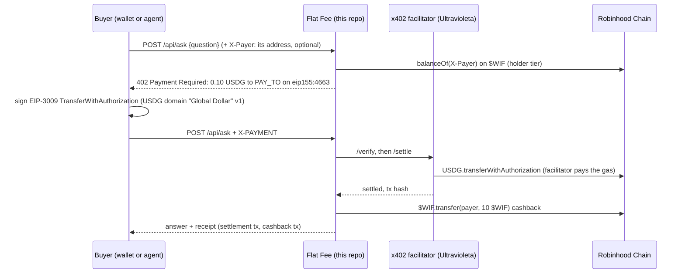

# Flat Fee

> Ask an agent or hire a human for a flat USDG fee per call, paid with one signature over x402 on Robinhood Chain.
> Paid calls send **$WIF** back (up to a daily budget), and $WIF holders pay half.

Built for the **world is flat hackathon** (Robinhood Chain). Demo video: `[VIDEO_URL]` · Live demo: https://flatfee.ultravioletadao.xyz ·
Form answers: [SUBMISSION.md](SUBMISSION.md) · Video shot list: [docs/DEMO-SCRIPT.md](docs/DEMO-SCRIPT.md)

## The problem

Agents can already answer questions and humans can already run errands, but there is no simple way to sell either one,
call by call, to anyone with a wallet. Subscriptions and API keys exclude agents, and card payments do not work for a
few cents. Robinhood Chain brings stablecoins to a mainstream audience, so we built the smallest useful storefront for
it: an HTTP endpoint that quotes a price in USDG, takes one signature, settles on chain, and serves the answer.

## What it does

- `POST /api/ask` answers questions about Robinhood Chain from live chain data: an address's ETH, USDG and $WIF, the
  latest block and gas, $WIF itself, or which x402 schemes the facilitator settles here.
- `POST /api/hire` hires a human for a small task. By default the task goes on Flat Fee's own board: a person claims
  it, answers it, and earns $WIF for it. With `EM_HIRE=on`, Flat Fee hires the human through
  **[Execution Market](https://execution.market)** instead: it publishes the task there as an agent, the merchant pays
  the worker's bounty into a USDG escrow on Robinhood Chain, Flat Fee approves the answer (the escrow pays the worker),
  and the worker earns 50 $WIF on top. See [Hiring through Execution Market](#hiring-a-human-through-execution-market).
- Both answer `402 Payment Required` with a price in USDG on Robinhood Chain. The buyer, a browser wallet or an agent,
  signs an EIP-3009 `transferWithAuthorization` for exactly that amount (no gas, no approve). Ultravioleta's
  open-source x402 facilitator verifies it and settles the USDG on chain, and the endpoint serves the call.
- **$WIF** is in the loop on chain: after a settled call the merchant wallet sends $WIF back to the payer (cashback,
  while the day's budget lasts), payers holding at least 100 $WIF get the holder price when they name their address
  before the 402, and humans who complete tasks are paid in $WIF.

### The $WIF flywheel

| what someone does | what happens to $WIF | why they come back |
|---|---|---|
| pays 0.10 USDG for an answer, or 0.50 USDG for a human | the merchant sends 10 $WIF back to them on Robinhood Chain | every 10 paid calls make them a $WIF holder |
| holds 100+ $WIF | it is read on chain (`balanceOf`) for the address they name before the 402, and checked against the address that signs | they pay half: 0.05 USDG per question, 0.25 USDG per task |
| completes a hire task (on the board, or on Execution Market) | the merchant sends them 50 $WIF | more $WIF, more tasks, and the holder price when they buy |

Cashback is kept well below the price (10 $WIF is about 0.012 USD at the pool price of 29 Oct 2026, about 12% of a
0.10 USDG call), so it cannot be farmed for profit. It is capped by `WIF_DAILY_BUDGET` (500 $WIF a day by default) and
by what the merchant wallet holds. It is off in `.env.example` (`WIF_CASHBACK=0`) and on (10 $WIF) in the deploy recipe.

The holder price needs the buyer to say who it is before the 402: `?payer=0x…` or an `X-Payer` header. The landing page
sends it from the connected wallet. A generic x402 client that sends neither is quoted, and pays, the standard price. The
hint only shapes the quote: the price is then checked against the address the payment is signed by, so a non-holder who
names a holder is refused.

## How it works



```
buyer ──POST──▶ Flat Fee ──402 (USDG price)──▶ buyer signs EIP-3009 ──X-PAYMENT──▶ Flat Fee ──verify/settle──▶ facilitator ──▶ Robinhood Chain
                    │                                                                  │
                    └── $WIF balanceOf (holder price)                                  └── answer + $WIF cashback ──▶ buyer
```

## Hiring a human through Execution Market

With `EM_HIRE=on`, "hire a human" runs on [Execution Market](https://execution.market), Ultravioleta's marketplace
where agents hire humans, with Flat Fee as the agent. The buyer pays Flat Fee exactly as before (x402, the holder price,
the $WIF cashback); then:

1. Flat Fee publishes the task on Execution Market for Robinhood Chain, signed by the merchant wallet (ERC-8128).
2. A human applies. Flat Fee assigns the applicant Execution Market ranks first (never the buyer) and the merchant pays
   the bounty (`EM_BOUNTY_USDG`, 0.20 USDG by default) into a **USDG escrow**, built with `uvd-x402-sdk`'s escrow builder.
3. The human delivers a text answer. Flat Fee opens it and approves it, and the escrow pays the human. A delivery
   without a usable answer is opened, then rejected with the reason: Execution Market keeps the escrow of a delivery
   its publisher read, so the human can deliver again and still be paid. If Execution Market sends the escrow back
   anyway, Flat Fee closes the task there instead of asking for more work.
4. Flat Fee sends the human **50 $WIF** on Robinhood Chain, and the buyer reads the answer at `GET /api/tasks/:id`.

It is **off by default, and off on the live demo**: Execution Market does not take Robinhood Chain tasks yet (its
escrow is not deployed there, and `uvd-x402-sdk` has no Robinhood row in its escrow tables). Until both exist, a server
with `EM_HIRE=on` answers `503` to a hire before the `402`, so nobody pays for a task that cannot run. The design, the
edge cases and the Execution Market API it uses: [docs/EXECUTION-MARKET.md](docs/EXECUTION-MARKET.md).

## Try it (judges: under 5 minutes, no wallet, no funds)

You need Node 22+ and [Foundry](https://book.getfoundry.sh) (`anvil`) for the fork runs.

1. `git clone https://github.com/0xultravioleta/worldisflat-x402 && cd worldisflat-x402 && npm install`
2. **`npm run demo`** and open http://localhost:3000. It runs on a local fork of Robinhood Chain mainnet with the real
   USDG and $WIF contracts, and has already paid for one question and one hire task from a throwaway wallet. You see
   both rows under **Paid calls**, each with its settlement and its $WIF cashback, and the task under **Task board**.
   Paste the worker token `demo`, enter any address, click **claim**, type an answer and click **complete**: the task
   turns `done` and the worker receives 50 $WIF. The **Pay … with wallet** buttons are off on the demo (see Safety). (The tx links point at the real explorer and do not resolve there:
   those transactions only exist on the fork.)
3. **`npm run e2e:fork`**: the whole flow as assertions, 22 checks on a fork of mainnet. You see `PASS` for: the 402
   terms, unpaid rejection of bad input, a paid question through the SDK, USDG moving payer → merchant, the settlement
   mined, the $WIF cashback, the landing page's own payment code, a replayed payment refused, three concurrent copies of one payment charged
   once, the holder price, a
   non-holder refused at the holder price, hire → claim → complete with the worker's $WIF, and the facilitator double
   refusing a wrong amount, recipient, asset, network, an expired authorization and a bad signature.
   `npm run e2e:fork -- robinhood-testnet` runs it on a testnet fork (18 checks, no $WIF there).
4. **`npm run verify:testnet`**: against the **real** facilitator on Robinhood Chain Testnet, read-only: the payer is a
   fresh throwaway wallet with no funds, so nothing can settle. Four `PASS` lines: our EIP-712 domain equals USDG's
   on-chain `DOMAIN_SEPARATOR()` on both chains, the facilitator takes a signed payment all the way to the balance
   check (`insufficient_funds`), and refuses an expired one (`invalid_timing`).
5. **`npm test`**: unit tests, no network (CI runs them on every push). They include charge-before-serve and replay
   (`test/settle.test.ts`), the $WIF budget, the mainnet run's approvals, every entry point started with a
   malformed key (`test/keys.test.ts`), and hiring through Execution Market against a double of its API: publish,
   escrow, delivery, approval, rejection and timeouts (`test/em.test.ts`).

On a real network: `cp .env.example .env`, set `PAY_TO`, `npm start`, then
`curl -i -X POST localhost:3000/api/ask -H 'content-type: application/json' -d '{"question":"latest block?"}'` → you see
`402 Payment Required` and the USDG terms. With a funded `PAYER_PRIVATE_KEY`, `npm run buy -- "your question"` pays and
prints the answer with the settlement link (on mainnet: `CONFIRM_MAINNET_SPEND=0.10`, with `PAY_TO` set to the expected
recipient).

The live demo is the same server on Robinhood Chain mainnet, with the $WIF cashback on:
`curl -i -X POST https://flatfee.ultravioletadao.xyz/api/ask -H 'content-type: application/json' -d '{"question":"latest block?"}'`
returns the same `402` with the mainnet USDG terms. Paying there spends real USDG: from the page with a wallet, or with
`npm run buy` and `NETWORK=robinhood`, `PAY_TO=0xb9056196d3D00b4c09ec2E5E123E30b376d39cC6`, `FLATFEE_URL=https://flatfee.ultravioletadao.xyz`
and `CONFIRM_MAINNET_SPEND` set to the amount the `402` asks for.

## Real transactions on Robinhood Chain mainnet

| what | transaction |
|---|---|
| USDG settlement through the facilitator (payer → merchant, 0.05 USDG: the holder price) | [0x432e…6f33](https://robinhoodchain.blockscout.com/tx/0x432e381183277e5f6b485adb0e4ff2cb072b59b38c80246c1b21efa99c446f33) |
| $WIF cashback (merchant → payer, 10 $WIF) | [0xb0f3…f640](https://robinhoodchain.blockscout.com/tx/0xb0f3433c98ec074ce3dff3fb2d567dd2fe63d7ba291425dc6e36d81de181f640) |

Both come from one paid question to the live demo, on 2 Nov 2026 at 02:38 UTC (blocks 103875528 and 103875599). The
payer held about 1,016 $WIF before the run (funded by the team; it has no ETH), so the demo quoted and settled the holder
price, 0.05 USDG instead of 0.10, and still sent the 10 $WIF cashback. The facilitator (`0x1030…13C7`) submitted the
settlement and paid its gas.

Wallets: payer `0x6Ce9DA69A46842DCe90e6a14382Ed06eb1c46af5`, merchant / pay-to `0xb9056196d3D00b4c09ec2E5E123E30b376d39cC6`.
The run that produced them: with `NETWORK=robinhood`, `PAY_TO` (the merchant), `WIF_CASHBACK=10`, `MERCHANT_PRIVATE_KEY`
and `PAYER_PRIVATE_KEY` in `.env`,
`FLATFEE_URL=https://flatfee.ultravioletadao.xyz CONFIRM_MAINNET_SPEND=0.05 CONFIRM_MAINNET_WIF=10 npm run e2e:mainnet`.
Before it reads the chain or signs, it refuses unless both amounts are given and match the configuration exactly, and it
refuses to settle USDG without the $WIF leg (`scripts/lib/live.ts`, `test/live.test.ts`). With `FLATFEE_URL` it pays
that server instead of starting its own, once the server's `/api/info` shows the same network, recipient, USDG, $WIF
token and holder minimum, ask prices and cashback as `.env`; that server sends the cashback with its own merchant key. The run passes only if the USDG
moved and the whole cashback landed on chain; this one printed `payer -0.05, pay-to +0.05 (PASS)` and `+10 $WIF`.

## Robinhood Chain, USDG, $WIF and x402: where in the code

| technology | how it is used | file |
|---|---|---|
| Robinhood Chain (mainnet 4663, testnet 46630) | chain ids, CAIP-2 names, public RPCs, explorers | `src/config.ts` (`CHAINS`) |
| USDG (Paxos Global Dollar, `0x5fc5…d168`) | the price of every call; EIP-712 domain `Global Dollar` / `1` sent in the 402 `extra` (its on-chain `version()` reverts) | `src/config.ts`, `src/app.ts` (paywalls) |
| $WIF (`0x5173b8ea6923c2d40267890d45c46a3480954773`) | holder tier (`balanceOf`), cashback and worker reward (`transfer`) | `src/chain.ts` (`tierOf`, `sendWif`), `src/app.ts` (`tierFor`, `cashback`, `/complete`) |
| x402 `exact` (EIP-3009) seller side | `createHonoMiddleware` from `uvd-x402-sdk`, one paywall per route and tier | `src/app.ts` |
| x402 buyer side | `X402Client` from `uvd-x402-sdk` (agents, CLI) | `scripts/lib/buyer.ts`, `scripts/buy.ts` |
| x402 in the browser | builds the EIP-712 payment and the `X-PAYMENT` header for a browser wallet | `public/x402-browser.js`, `public/app.js` |
| Ultravioleta x402 facilitator | verifies and settles USDG on Robinhood Chain, pays the gas | `FACILITATOR_URL`, default `https://facilitator.ultravioletadao.xyz` |
| Execution Market (`EM_HIRE=on`) | Flat Fee as an agent: ERC-8128-signed REST calls, the USDG escrow lock (`buildEscrowPreAuth`), review and approval, the worker's $WIF | `src/em.ts`, `src/escrow.ts`, `src/emhire.ts` |

## What existed before, and what was built during the hackathon

Pre-existing, used only through public interfaces: Robinhood Chain, USDG, $WIF, Uniswap v4 (where $WIF trades),
[Execution Market](https://github.com/UltravioletaDAO/execution-market) (its REST API),
Ultravioleta's Rust x402 facilitator ([x402-rs](https://github.com/UltravioletaDAO/x402-rs), Robinhood Chain + USDG
support since July 2026, see its `docs/ROBINHOOD_CHAIN.md`), and the
[uvd-x402-sdk](https://github.com/UltravioletaDAO/uvd-x402-sdk-typescript) npm package.

Built during the hackathon, all in this repo (first commit `2e9072e`, 29 Oct 2026): the app (`src/`), the landing page
and its browser payment code (`public/`), the $WIF tier, cashback and worker reward, the facilitator double and the fork
runs (`src/double/`, `scripts/`), the tests (`test/`), the deploy recipe (`Dockerfile`, `deploy/aws/`), and hiring
through Execution Market behind `EM_HIRE` (`src/em.ts`, `src/escrow.ts`, `src/emhire.ts`, 4 Nov 2026).

## Safety

- Keys live in `.env` (gitignored) for local runs. A malformed key is refused by name and never printed: `loadConfig`
  and every script check it before ethers sees it (`test/config.test.ts`; `test/keys.test.ts` starts each entry point
  with a key one digit short). `npm run balances` prints addresses only. The deploy recipe is different: it puts
  `MERCHANT_PRIVATE_KEY` in `terraform.tfvars` (gitignored), in the Terraform state (plain text) and in the container's
  environment on Lightsail, readable by anyone with Lightsail access in the account. That wallet holds only the cashback
  budget and a little gas.
- Mainnet spends need the exact amount on the command line (`CONFIRM_MAINNET_SPEND`, `CONFIRM_MAINNET_WIF`) and the
  expected recipient (`PAY_TO` or `CONFIRM_MAINNET_PAY_TO`). The SDK re-reads the 402 before it signs, so the buyer pins
  its choice to the offer it checked: same network, USDG, same recipient, same amount, or nothing is signed
  (`test/buyer.test.ts`).
- The price is decided from the same payment header the SDK pays from (`PAYMENT-SIGNATURE`, else `X-PAYMENT`); a request
  carrying two different payment headers is refused.
- The holder price comes from the address the signature commits to, never from a header: a non-holder who signs the
  holder price is refused (tested on the fork and in `test/app.test.ts`).
- The payment settles before the call is served: the SDK's paywall settles first (`settlementStrategy: "before-handler"`,
  written down in `src/app.ts`), and the handler still refuses a payment whose settlement did not succeed.
- Only a new settlement is served, and it pays its cashback once. A resend of a payment that already settled is refused,
  one after the other or several at once: unbound, the SDK refuses it; bound with `X-UVD-Purchase`, the facilitator
  answers with the original success marked as a replay, and the app answers `409` with the settlement hash, without
  serving it or sending $WIF. That check needs nothing on disk, so it holds after a restart with an empty `DATA_DIR`.
  As a second layer, for a facilitator that would not mark the replay, the ledger in `state.json` refuses an
  authorization (payer and nonce) it already served; that layer lasts only as long as `DATA_DIR` does
  (`test/settle.test.ts`, in CI).
- Bad input is refused before the 402, so nobody pays for a rejected request. A failed cashback never fails a paid
  call; the ledger records why. A call that fails after its settlement still answers with the receipt. Error text is
  stripped of URLs before it is stored or returned (an RPC URL can carry an API key).
- The merchant wallet is the hard cap: give it only the $WIF you are willing to give away. On top of that,
  `WIF_DAILY_BUDGET` (default 500 $WIF) caps what the server sends per UTC day, cashback and rewards together. It is kept
  in `DATA_DIR/state.json`, so a restart that keeps the disk does not refill it; a fresh `DATA_DIR` does (on Lightsail,
  every restart or redeploy of the container starts with an empty disk), and so does `npm run reset`. A transfer that was broadcast counts as sent even if it was
  not seen mined.
- `npm run demo` runs on a fork with mainnet's chain id, so a signature made there is valid on mainnet: the page turns
  browser-wallet payments off on the demo, and only the demo's throwaway wallet signs.
- Hiring and the task board are off without `WORKER_TOKEN` (compared in constant time). Only the worker who claimed a
  task can complete it, and the payer of a task cannot claim it. Workers holding the token are trusted operators.
- Through Execution Market, the merchant wallet signs one kind of payment only: a USDG escrow lock of exactly
  `EM_BOUNTY_USDG` for the worker Flat Fee assigned, never a payment straight to a worker. Before it signs, the escrow,
  operator, token collector, chain and token that Execution Market publishes must equal Flat Fee's own configuration;
  after, the signed authorization is checked again (amount, recipient, receiver, nonce, signer). `EM_BOUNTY_USDG` cannot
  be above the holder price of a hire, so a hire's price covers its bounty. A hire Flat Fee can tell would not run
  (Execution Market cannot take it, its escrow builder cannot build one, the merchant cannot fund one more escrow, or
  Execution Market refused the last task for this server's settings or identity) is refused before the 402, and so is
  a request Execution Market's own public rules would refuse to publish (a sale listing, a cloud credential or
  pre-signed URL, text that is not valid Unicode).
  The merchant also signs, at approval and only when Execution Market asks for it, the payer's release order for that
  escrow. The worker is paid
  $WIF only for a delivery Flat Fee accepted. With `EM_HIRE=on` the merchant wallet holds USDG for the bounties as well
  as $WIF, and `DATA_DIR` must persist while hires are open: a task in flight lives there, and the Lightsail recipe
  loses it on every restart (a lost one is still paid by Execution Market's own release, without the $WIF).
- A corrupt `state.json` stops the server instead of being overwritten; `npm run reset` clears it.
- If the RPC cannot be read when a payment arrives, the payer is charged the standard price, never less: a holder in that
  moment gets a 402 at the standard price and can pay it or retry.

## Configuration

See `.env.example`. The main settings: `NETWORK` (`robinhood-testnet` or `robinhood`), `PAY_TO`, the four prices,
`WIF_HOLDER_MIN`, `WIF_CASHBACK`, `WIF_WORKER_REWARD`, `WIF_DAILY_BUDGET`, `MERCHANT_PRIVATE_KEY`, `WORKER_TOKEN`,
`FACILITATOR_URL`, and for hiring through Execution Market `EM_HIRE`, `EM_API_URL`, `EM_BOUNTY_USDG`, the three escrow
contracts (`EM_ESCROW_ADDRESS`, `EM_OPERATOR_ADDRESS`, `EM_TOKEN_COLLECTOR_ADDRESS`) and the rest in
[docs/EXECUTION-MARKET.md](docs/EXECUTION-MARKET.md#configuration). `npm run reset` clears the ledger, the task board
and the day's $WIF budget before a recording.

## Deploy

`docker build -t flatfee .` builds one small container (`npm start` inside). `deploy/aws/main.tf` runs it on AWS
Lightsail Containers in us-east-2 (nano, 7 USD a month): push the image with
`aws lightsail push-container-image --region us-east-2 --service-name flatfee --label web --image flatfee`, set the
pushed image name and the values in `deploy/aws/terraform.tfvars` (from the `.example`; `worker_token` is required, at
least 16 characters), then `terraform apply`. `terraform destroy` turns it off. See Safety for where the merchant key
ends up. The custom domain (`flatfee.ultravioletadao.xyz`) and its certificate are attached outside terraform, which
leaves them alone (`ignore_changes`). Every apply that changes the container's environment redeploys it, and the new
container starts with an empty `DATA_DIR`.

## What's next

Turning on hiring through Execution Market on the live demo once it takes Robinhood Chain escrows (the code is in, behind
`EM_HIRE`), with the reputation of each task written on Robinhood Chain (ERC-8004), an LLM behind the agent, and
subscriptions priced in $WIF.

## Team

Ultravioleta DAO: Saúl (`[SAUL_X_HANDLE]`) and c0der. Built with help from AI coding agents.

## License

MIT, see [LICENSE](LICENSE). Flat Fee is not affiliated with, endorsed by, or officially connected with
Robinhood Markets, Inc.
