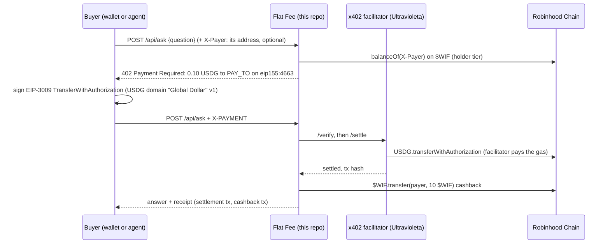

# Flat Fee

> Ask an agent or hire a human for a flat USDG fee per call, paid with one signature over x402 on Robinhood Chain.
> Paid calls send **$WIF** back (up to a daily budget), and $WIF holders pay half.

Built for the **world is flat hackathon** (Robinhood Chain). Demo video: https://youtu.be/oRGfZMNiinI · Live demo: https://flatfee.ultravioletadao.xyz ·
Form answers: [SUBMISSION.md](SUBMISSION.md) · Video shot list: [docs/DEMO-SCRIPT.md](docs/DEMO-SCRIPT.md)

## The problem

Agents can already answer questions and humans can already run errands, but there is no simple way to sell either one,
call by call, to anyone with a wallet. Subscriptions and API keys exclude agents, and card payments do not work for a
few cents. Robinhood Chain brings stablecoins to a mainstream audience, so we built the smallest useful storefront for
it: an HTTP endpoint that quotes a price in USDG, takes one signature, settles on chain, and serves the answer.

## What it does

- `POST /api/ask` answers questions about Robinhood Chain from live chain data: an address's ETH, USDG and $WIF, the
  latest block and gas, $WIF itself, or which x402 schemes the facilitator settles here.
- `POST /api/hire` hires a human for a small task. On the live demo the task goes to
  **[Execution Market](https://execution.market)** (`EM_HIRE=on` there since 7 Nov 2026): Flat Fee publishes it there
  as an agent, the merchant wallet pays the worker's bounty into a USDG escrow on Robinhood Chain, Flat Fee approves the
  answer (the escrow pays the worker), and the worker earns 50 $WIF on top. See
  [Hiring a human through Execution Market](#hiring-a-human-through-execution-market) and the
  [first hire it ran on mainnet](#a-hire-through-execution-market-7-nov-2026) (its worker was a team test wallet driven
  by a script, not a person). With `EM_HIRE` off (the default in the code, and `npm run demo`), the task goes on Flat
  Fee's own board instead: a person claims it, answers it, and earns $WIF for it.
- Both answer `402 Payment Required` with a price in USDG on Robinhood Chain. The buyer, a browser wallet or an agent,
  signs an EIP-3009 `transferWithAuthorization` for exactly that amount (no gas, no approve). Ultravioleta's
  open-source x402 facilitator verifies it and settles the USDG on chain, and the endpoint serves the call.
- **$WIF** is in the loop on chain: after a settled call the merchant wallet sends $WIF back to the payer (cashback,
  while the day's budget lasts), payers holding at least 100 $WIF get the holder price when they name their address
  before the 402, and humans who complete tasks are paid in $WIF.

### The $WIF flywheel

| what someone does | what happens to $WIF | why they come back |
|---|---|---|
| pays 0.10 USDG for an answer, or 0.50 USDG for a human | the merchant sends 10 $WIF back to them on Robinhood Chain | every 10 paid calls make them a $WIF holder |
| holds 100+ $WIF | it is read on chain (`balanceOf`) for the address they name before the 402, and checked against the address that signs | they pay half: 0.05 USDG per question, 0.25 USDG per task |
| completes a hire task (on the board, or on Execution Market) | the merchant sends them 50 $WIF | more $WIF, more tasks, and the holder price when they buy |

Cashback is kept well below the price (10 $WIF is about 0.012 USD at the pool price of 29 Oct 2026, about 12% of a
0.10 USDG call), so it cannot be farmed for profit. It is capped by `WIF_DAILY_BUDGET` (500 $WIF a day by default) and
by what the merchant wallet holds. It is off in `.env.example` (`WIF_CASHBACK=0`) and on (10 $WIF) in the deploy recipe.

The holder price needs the buyer to say who it is before the 402: `?payer=0x…` or an `X-Payer` header. The landing page
sends it from the connected wallet. A generic x402 client that sends neither is quoted, and pays, the standard price. The
hint only shapes the quote: the price is then checked against the address the payment is signed by, so a non-holder who
names a holder is refused.

## How it works



```
buyer ──POST──▶ Flat Fee ──402 (USDG price)──▶ buyer signs EIP-3009 ──X-PAYMENT──▶ Flat Fee ──verify/settle──▶ facilitator ──▶ Robinhood Chain
                    │                                                                  │
                    └── $WIF balanceOf (holder price)                                  └── answer + $WIF cashback ──▶ buyer
```

## Hiring a human through Execution Market

With `EM_HIRE=on`, "hire a human" runs on [Execution Market](https://execution.market), Ultravioleta's marketplace
where agents hire humans, with Flat Fee as the agent. The buyer pays Flat Fee exactly as before (x402, the holder price,
the $WIF cashback); then:

1. Flat Fee publishes the task on Execution Market for Robinhood Chain, signed by the merchant wallet (ERC-8128).
2. A human applies. Flat Fee assigns the applicant Execution Market ranks first (never the buyer) and the merchant pays
   the bounty (`EM_BOUNTY_USDG`, 0.20 USDG by default) into a **USDG escrow**, built with `uvd-x402-sdk`'s escrow builder.
3. The human delivers a text answer. Flat Fee opens it and approves it, and the escrow pays the human. A delivery
   without a usable answer is opened, then rejected with the reason: Execution Market keeps the escrow of a delivery
   its publisher read, so the human can deliver again and still be paid. If Execution Market sends the escrow back
   anyway, Flat Fee closes the task there instead of asking for more work.
4. Flat Fee sends the human **50 $WIF** on Robinhood Chain, and the buyer reads the answer at `GET /api/tasks/:id`.

**The live demo has run it since 7 Nov 2026**: `curl -s https://flatfee.ultravioletadao.xyz/api/info` answers
`hire.via: "execution-market"`, with the bounty (`0.2` USDG), the deadline (`24` hours) and whether a hire would be
taken right now (`hire.available`). It stays off by default in the code (`EM_HIRE=off`) and in `npm run demo`, which
keep the task board. Execution Market publishes its Robinhood Chain escrow (USDG), and `uvd-x402-sdk` builds escrows
there from 2.114.0, the version pinned here. With `EM_HIRE=on`, a server answers `503` to a hire before the `402`
whenever Execution Market or the merchant wallet cannot carry it, so nobody pays for a task that cannot run. The first
hire it ran on mainnet, with every transaction, is under
[A hire through Execution Market](#a-hire-through-execution-market-7-nov-2026); its worker was a team test wallet driven
by a script, not a person.
The design, the edge cases and the Execution Market API it uses: [docs/EXECUTION-MARKET.md](docs/EXECUTION-MARKET.md).

**If nobody takes the task.** The server says what happens before anyone pays, in `GET /api/info` (`hire.expiry`) and
again in the `201` of a paid `POST /api/hire`. On the live demo it reads, word for word:

> The task is on Execution Market, for any of its people to take. If no one takes it within 24 h, it expires there, with nothing locked for it. If the person who takes it does not deliver by then, Execution Market returns the escrowed pay to Flat Fee's wallet. Either way, the fee you paid is not refunded.

**Flat Fee's identity on Execution Market.** Execution Market requires an ERC-8004 identity on Base of every agent that
publishes. The merchant wallet (`0xb9056196d3D00b4c09ec2E5E123E30b376d39cC6`) has one: agent **1170265** on Base,
registered once and gaslessly with `npm run em:register` on 7 Nov 2026. Ultravioleta's facilitator (`0x1030…13C7`, the
one that settles the x402 payments too) minted it and paid the gas
([0x5323…82c8](https://basescan.org/tx/0x53234d1747e29f3fb73b7bb1a06e2dce77bcdd2cfde54b8f7348389fb46682c8)), then
transferred it to the merchant
([0xf79f…74a6](https://basescan.org/tx/0xf79f1e26efa7d1da49a7b46067200f7b93c4ef7a5b34041b3bb79c0e39fb74a6)).
Execution Market's own public record of it:
https://api.execution.market/api/v1/reputation/register/wallet/0xb9056196d3D00b4c09ec2E5E123E30b376d39cC6?network=base
On Robinhood Chain the merchant is agent **22487**, in the same ERC-8004 identity registry
(`0x8004A169FB4a3325136EB29fA0ceB6D2e539a432`): on 7 Nov 2026 at 18:47 UTC, seconds before Flat Fee's first task there
was published, the same facilitator minted it
([0x17a5…b0b8](https://robinhoodchain.blockscout.com/tx/0x17a5b782dff1cee05d86d2f7631eee9fca71594e68eeafa8d9651282873db0b8))
and transferred it to the merchant
([0x0508…4ae8](https://robinhoodchain.blockscout.com/tx/0x0508b6705a7ceb3bec6f1bb8bc4c52ccdff1d090275d32b19cc35243e6274ae8)).
Execution Market's record of it:
https://api.execution.market/api/v1/reputation/register/wallet/0xb9056196d3D00b4c09ec2E5E123E30b376d39cC6?network=robinhood

**Ratings.** Flat Fee sends no `reputation_network` with its tasks (`EM_REPUTATION_NETWORK` is empty in the deploy's
settings, `deploy/aws/em-hire.env`), so Execution Market picks the network the ratings are written on. Ratings on
Robinhood Chain wait until the SDK Execution Market runs on (the Python `uvd-x402-sdk`) lists Robinhood Chain among the
networks it can relay ratings on; it does not today, and Execution Market refuses a task that asks for it
(`422 invalid_reputation_network`; the sources are in
[docs/EXECUTION-MARKET.md](docs/EXECUTION-MARKET.md#configuration), `EM_REPUTATION_NETWORK`). Its public list of
networks says the same: robinhood is not selectable for ratings (https://api.execution.market/api/v1/reputation/networks).
Read on 12 Nov 2026, neither of Flat Fee's identities has a rating yet: the ERC-8004 reputation registry lists no rater
for agent 1170265 on Base nor for agent 22487 on Robinhood Chain. Flat Fee itself does not rate its workers yet.

## Try it (judges: under 5 minutes, no wallet, no funds)

You need Node 22+, [Foundry](https://book.getfoundry.sh) (`anvil`) for the fork runs, and an RPC of Robinhood Chain in
`RPC_URL`: Flat Fee has no default RPC and refuses to start without one. Use your own; if you have none, Robinhood Chain
documents public ones (`https://rpc.mainnet.chain.robinhood.com`, `https://rpc.testnet.chain.robinhood.com`). The live
demo runs on a private one.

1. `git clone https://github.com/0xultravioleta/worldisflat-x402 && cd worldisflat-x402 && npm install`
2. **`NETWORK=robinhood RPC_URL=<a mainnet RPC> npm run demo`** and open http://localhost:3000. It runs on a local fork of Robinhood Chain mainnet, made through that RPC, with the real
   USDG and $WIF contracts, and has already paid for one question and one hire task from a throwaway wallet. You see
   both rows under **Paid calls**, each with its settlement and its $WIF cashback, and the task under **Task board**
   (both open on their own on the fork). Enter any address and the worker token `demo`, click **Claim**, type an answer
   and click **Complete**: the task turns `done` and the worker receives 50 $WIF. The **Pay …** buttons are off on the
   demo (see Safety). (The tx links point at the real explorer and do not resolve there:
   those transactions only exist on the fork.)
3. **`NETWORK=robinhood RPC_URL=<a mainnet RPC> npm run e2e:fork`**: the whole flow as assertions, 22 checks on a fork of mainnet. You see `PASS` for: the 402
   terms, unpaid rejection of bad input, a paid question through the SDK, USDG moving payer → merchant, the settlement
   mined, the $WIF cashback, the landing page's own payment code, a replayed payment refused, three concurrent copies of one payment charged
   once, the holder price, a
   non-holder refused at the holder price, hire → claim → complete with the worker's $WIF, and the facilitator double
   refusing a wrong amount, recipient, asset, network, an expired authorization and a bad signature.
   `NETWORK=robinhood-testnet RPC_URL=<a testnet RPC> npm run e2e:fork -- robinhood-testnet` runs it on a testnet fork (18 checks, no $WIF there).
4. **`NETWORK=robinhood-testnet RPC_URL=<a testnet RPC> npm run verify:testnet`**: against the **real** facilitator on
   Robinhood Chain Testnet, read-only: the payer is a fresh throwaway wallet with no funds, so nothing can settle. Three
   `PASS` lines: our EIP-712 domain equals USDG's on-chain `DOMAIN_SEPARATOR()` on testnet (mainnet's is proven by the
   fork run, where USDG accepts the signature, and by the mainnet runs below), the facilitator takes a signed payment
   all the way to the balance check (`insufficient_funds`), and refuses an expired one (`invalid_timing`).
5. **`npm test`**: unit tests, no network (CI runs them on every push). They include charge-before-serve and replay
   (`test/settle.test.ts`), the $WIF budget, the mainnet run's approvals, every entry point started with a
   malformed key (`test/keys.test.ts`), hiring through Execution Market against a double of its API: publish,
   escrow, delivery, approval, rejection and timeouts (`test/em.test.ts`), and this README's and SUBMISSION.md's
   evidence of the first hire on mainnet against the run's own output, and each text SUBMISSION.md gives for the
   submission form within its field's cap (`test/docs.test.ts`).

On a real network: `cp .env.example .env`, set `PAY_TO` and `RPC_URL`, `npm start`, then
`curl -i -X POST localhost:3000/api/ask -H 'content-type: application/json' -d '{"question":"latest block?"}'` → you see
`402 Payment Required` and the USDG terms. With a funded `PAYER_PRIVATE_KEY`, `npm run buy -- "your question"` pays and
prints the answer with the settlement link (on mainnet: `CONFIRM_MAINNET_SPEND=0.10`, with `PAY_TO` set to the expected
recipient).

The live demo is the same server on Robinhood Chain mainnet, with the $WIF cashback on:
`curl -i -X POST https://flatfee.ultravioletadao.xyz/api/ask -H 'content-type: application/json' -d '{"question":"latest block?"}'`
returns the same `402` with the mainnet USDG terms. Paying there spends real USDG: from the page with a wallet, or with
`npm run buy` and `NETWORK=robinhood`, `PAY_TO=0xb9056196d3D00b4c09ec2E5E123E30b376d39cC6`, `FLATFEE_URL=https://flatfee.ultravioletadao.xyz`
and `CONFIRM_MAINNET_SPEND` set to the amount the `402` asks for. A hire paid there (0.50 USDG, 0.25 for $WIF holders)
publishes a real task on Execution Market, for any of its people to take within 24 hours
([Hiring a human through Execution Market](#hiring-a-human-through-execution-market)).

## Real transactions on Robinhood Chain mainnet

### A paid question (2 Nov 2026)

| what | transaction |
|---|---|
| USDG settlement through the facilitator (payer → merchant, 0.05 USDG: the holder price) | [0x432e…6f33](https://robinhoodchain.blockscout.com/tx/0x432e381183277e5f6b485adb0e4ff2cb072b59b38c80246c1b21efa99c446f33) |
| $WIF cashback (merchant → payer, 10 $WIF) | [0xb0f3…f640](https://robinhoodchain.blockscout.com/tx/0xb0f3433c98ec074ce3dff3fb2d567dd2fe63d7ba291425dc6e36d81de181f640) |

Both come from one paid question to the live demo, on 2 Nov 2026 at 02:38 UTC (blocks 103875528 and 103875599). The
payer held about 1,016 $WIF before the run (funded by the team; it has no ETH), so the demo quoted and settled the holder
price, 0.05 USDG instead of 0.10, and still sent the 10 $WIF cashback. The facilitator (`0x1030…13C7`) submitted the
settlement and paid its gas.

Wallets: payer `0x6Ce9DA69A46842DCe90e6a14382Ed06eb1c46af5`, merchant / pay-to `0xb9056196d3D00b4c09ec2E5E123E30b376d39cC6`.
The run that produced them: with `NETWORK=robinhood`, `PAY_TO` (the merchant), `WIF_CASHBACK=10`, `MERCHANT_PRIVATE_KEY`
and `PAYER_PRIVATE_KEY` in `.env`,
`FLATFEE_URL=https://flatfee.ultravioletadao.xyz CONFIRM_MAINNET_SPEND=0.05 CONFIRM_MAINNET_WIF=10 npm run e2e:mainnet`.
Before it reads the chain or signs, it refuses unless both amounts are given and match the configuration exactly, and it
refuses to settle USDG without the $WIF leg (`scripts/lib/live.ts`, `test/live.test.ts`). With `FLATFEE_URL` it pays
that server instead of starting its own, once the server's `/api/info` shows the same network, recipient, USDG, $WIF
token and holder minimum, ask prices and cashback as `.env`; that server sends the cashback with its own merchant key. The run passes only if the USDG
moved and the whole cashback landed on chain; this one printed `payer -0.05, pay-to +0.05 (PASS)` and `+10 $WIF`.

### A hire through Execution Market (7 Nov 2026)

One hire bought from the live demo with `npm run e2e:hire`, on 7 Nov 2026 from 18:47 to 18:50 UTC, every payment on
Robinhood Chain mainnet. **The worker in this run is a test wallet of the team, driven by a script, that declares itself
to Execution Market as a PayBox client (`human_via_agent`); it is not a person and not a real customer.** No person took
this task: its text on Execution Market asked to leave it to the test worker. The buyer is the team's payer wallet, the
same one as on 2 Nov.

| step | what moved | transaction |
|---|---|---|
| the buyer pays the hire over x402 (the holder price: the buyer holds $WIF) | 0.25 USDG, buyer → merchant | [0xffea…dd54](https://robinhoodchain.blockscout.com/tx/0xffea67a1b62bfc374682ca3a36e19fb9be7c4997e3c53a8937024f10bdcedd54) |
| the $WIF cashback | 10 $WIF, merchant → buyer | [0xf431…030a](https://robinhoodchain.blockscout.com/tx/0xf4318a5ef5871332a7b029e66f3315cc161e1ffe03267c1ad04662546cad030a) |
| Flat Fee publishes the task on Execution Market | task `3175424d-4f83-45cc-b871-92d9dcd3ffe3` | off chain: [its public record](https://api.execution.market/api/v1/tasks/3175424d-4f83-45cc-b871-92d9dcd3ffe3) |
| the test worker applies, Flat Fee assigns it, and the merchant locks the bounty | 0.20 USDG, merchant → Execution Market's escrow | [0x4eae…43d9](https://robinhoodchain.blockscout.com/tx/0x4eae3196450ccbfff305bd9dbdd114005a8c37c0ed4d088c704b62231e1643d9) |
| the test worker delivers a text, Flat Fee approves it, and the escrow pays | 0.174 USDG to the worker: the 0.20 bounty less Execution Market's 13% fee | [0xe72b…e346](https://robinhoodchain.blockscout.com/tx/0xe72bca30f5cf8c183525889de728d0799fe462f77164bba762858505b7bfe346) |
| Flat Fee's reward for the delivery it approved | 50 $WIF, merchant → worker | [0xde1a…ade6](https://robinhoodchain.blockscout.com/tx/0xde1aa451397d68bfa3a1e12ad0a57cadb60dc3c36a8d316bd5a7decbc37fade6) |

What the run read on chain at the end: the buyer -0.25 USDG and +10 $WIF, the worker +0.174 USDG and +50 $WIF, and the
merchant +0.05 USDG (the 0.25 it was paid, less the 0.20 it locked). Execution Market's public record of the task shows
it `completed`, its escrow `released`, its executor as `human_via_agent` and its publisher as ERC-8004 agent `1170265`.

Wallets: buyer `0x6Ce9DA69A46842DCe90e6a14382Ed06eb1c46af5`, merchant / pay-to
`0xb9056196d3D00b4c09ec2E5E123E30b376d39cC6`, test worker `0xa329b5FB85cf76E1d235711AFc096B76374271c7` (a team wallet,
not a person). The run's output, word for word, with its exit code (`rc=0`) on the last line:
[docs/evidence/e2e-hire-2026-11-07.txt](docs/evidence/e2e-hire-2026-11-07.txt) (`"ok": true`, no problems).
`test/docs.test.ts` checks this section and the texts that cite the run in [SUBMISSION.md](SUBMISSION.md) against it:
each transaction's hash, the amounts and the direction written next to it and no other amount, the end balances, the
time, the task and the wallets. What the run checks, and what it refuses before it pays:
[docs/EXECUTION-MARKET.md](docs/EXECUTION-MARKET.md#the-end-to-end-run-npm-run-e2ehire).

### Two more paid calls from the team (7 and 8 Nov 2026)

A paid question to the live demo on 7 Nov 2026, and a second hire through Execution Market on 8 Nov 2026, both bought by
the team's payer wallet (`0x6Ce9…6af5`). The second hire's worker is the same team test wallet as the first's
(`0xa329…71c7`): a script, not a person. Its task on Execution Market,
https://api.execution.market/api/v1/tasks/d161b088-ae87-44df-8ed3-5af09018c779, is `completed` with its escrow
`released`, and names its publisher as agent `22487`, the merchant's identity on Robinhood Chain.

| when (UTC) | what moved | transaction |
|---|---|---|
| 7 Nov 20:07 | a paid question at the holder price: 0.05 USDG, buyer → merchant | [0x5fe7…2213](https://robinhoodchain.blockscout.com/tx/0x5fe7d69d3d5ce44649d644bb25174a366d71da0069accf0b82a214e80f082213) |
| 7 Nov 20:07 | its $WIF cashback: 10 $WIF, merchant → buyer | [0xc3c5…3367](https://robinhoodchain.blockscout.com/tx/0xc3c5d09e7f06e06ec1a0936ca928ffa72a28efbb2762c2b92841548ec4143367) |
| 8 Nov 18:05 | a hire at the holder price: 0.25 USDG, buyer → merchant | [0xf710…da03](https://robinhoodchain.blockscout.com/tx/0xf710dc423f7108a9bc94c40510f9d822c2c34afa764e2ad18f89c4ccbfc8da03) |
| 8 Nov 18:05 | its $WIF cashback: 10 $WIF, merchant → buyer | [0x19a3…01d6](https://robinhoodchain.blockscout.com/tx/0x19a3e6643cb0f0a6a01b3bccf11fabdae9fd7ce63ecb257fdcba08c1f58b01d6) |
| 8 Nov 18:06 | the test worker is assigned and the merchant locks the bounty: 0.2 USDG, merchant → Execution Market's escrow | [0x7452…8bab](https://robinhoodchain.blockscout.com/tx/0x74525b5e060e0df0763421a8a2ba265fc2959490b03f61202ec1154c89fe8bab) |
| 8 Nov 18:06 | the test worker delivers a text, Flat Fee approves it, and the escrow pays: 0.174 USDG to the worker, 0.026 USDG to Execution Market (its 13% fee) | [0xb005…d68e](https://robinhoodchain.blockscout.com/tx/0xb0053fcc8c33ee17b34eb3d898c541eef8f12170134da323ffbc2acde62dd68e) |
| 8 Nov 18:07 | Flat Fee's reward for the delivery it approved: 50 $WIF, merchant → worker | [0xe208…2a2f](https://robinhoodchain.blockscout.com/tx/0xe2086ab4a8d6ae2c8a4381d2aaa6acfbc5a8928d795b722876d89d17667a2a2f) |

With the paid question of 2 Nov and the hire of 7 Nov, these are every paid call to the merchant and every $WIF
transfer it has made on Robinhood Chain mainnet, read on chain on 12 Nov 2026: six $WIF transfers, all of them to
wallets of the team (the merchant has sent six transactions in all, its nonce). The reads, with the blocks they cover:
[docs/evidence/robinhood-2026-11-12.json](docs/evidence/robinhood-2026-11-12.json).

### The same market, used by our agent swarm (11-12 Nov 2026)

[KarmaKadabra](https://karmakadabra.ultravioletadao.xyz) is Ultravioleta DAO's swarm of AI agents, which hire each
other on Execution Market. On Robinhood Chain, in USDG, two of its agents published a task each on 11 Nov 2026, two
other agents of the swarm took them, and their buyers approved the deliveries on 12 Nov 2026: Execution Market's
records show both `completed`, their escrows `released`. Flat Fee is not a party to these tasks; they are the market
Flat Fee hires on, in use on Robinhood Chain by other agents. The agents and their wallets are in the swarm's public
graph (https://karmakadabra.ultravioletadao.xyz/graph.json).

| task (Execution Market's public page) | step | what moved | transaction |
|---|---|---|---|
| [3f8c7506…](https://execution.market/tasks/3f8c7506-4069-4ee5-9306-de63b8224aec) | a buyer agent of the swarm locks the bounty | 0.01 USDG, buyer → Execution Market's escrow | [0x6aa6…36ec](https://robinhoodchain.blockscout.com/tx/0x6aa6cac797713a2f288772c68bcf7f499ac1b1a31a5fa17b64aa3314235836ec) |
| | kk-coordinator delivers, the buyer agent approves, and the escrow pays | 0.0087 USDG to kk-coordinator, 0.0013 USDG to Execution Market (its 13% fee) | [0x37e1…77ec](https://robinhoodchain.blockscout.com/tx/0x37e1c21aeafe67de99c0d65f5a2272569f726faddc869a03d6113fe6670a77ec) |
| [c03d5028…](https://execution.market/tasks/c03d5028-ff09-427e-b780-1329e8075bb8) | a buyer agent of the swarm locks the bounty | 0.01 USDG, buyer → Execution Market's escrow | [0xfe46…0ae9](https://robinhoodchain.blockscout.com/tx/0xfe461c2b8edcd8aef91b3fb6b78845302d441a2ab7d128633e033ebae0d10ae9) |
| | kk-trader delivers, the buyer agent approves, and the escrow pays | 0.0087 USDG to kk-trader, 0.0013 USDG to Execution Market (its 13% fee) | [0x39b4…c405](https://robinhoodchain.blockscout.com/tx/0x39b4c377018195e29002bfe08c80980f2428c7f3ab290e43916b882a3919c405) |

Both sides of each of these tasks and of Flat Fee's two hires, the publisher and the worker, hold an ERC-8004 identity
on Robinhood Chain, each minted by Ultravioleta's facilitator (`0x1030…13C7`) and transferred to its wallet: Flat Fee's
merchant 22487 and its test worker
22488 (7 Nov 2026), the swarm's two buyers 23394 and 23395 and its two workers 25419 (kk-coordinator) and 25420
(kk-trader) (11 Nov 2026). None has a rating there yet (see Ratings above). On Base, where Execution Market writes its
ratings today, the swarm's four agents already carry ratings from earlier tasks: on their ERC-8004 identities there, the
two buyers have 18 and 26 raters (agents 18897 and 18815), kk-coordinator 3 (18775) and kk-trader 1 (59622).

## Robinhood Chain, USDG, $WIF and x402: where in the code

| technology | how it is used | file |
|---|---|---|
| Robinhood Chain (mainnet 4663, testnet 46630) | chain ids, CAIP-2 names, public RPCs, explorers | `src/config.ts` (`CHAINS`) |
| USDG (Paxos Global Dollar, `0x5fc5…d168`) | the price of every call; EIP-712 domain `Global Dollar` / `1` sent in the 402 `extra` (its on-chain `version()` reverts) | `src/config.ts`, `src/app.ts` (paywalls) |
| $WIF (`0x5173b8ea6923c2d40267890d45c46a3480954773`) | holder tier (`balanceOf`), cashback and worker reward (`transfer`) | `src/chain.ts` (`tierOf`, `sendWif`), `src/app.ts` (`tierFor`, `cashback`, `/complete`) |
| x402 `exact` (EIP-3009) seller side | `createHonoMiddleware` from `uvd-x402-sdk`, one paywall per route and tier | `src/app.ts` |
| x402 buyer side | `X402Client` from `uvd-x402-sdk` (agents, CLI) | `scripts/lib/buyer.ts`, `scripts/buy.ts` |
| x402 in the browser | builds the EIP-712 payment and the `X-PAYMENT` header for a browser wallet | `public/x402-browser.js`, `public/app.js` |
| Ultravioleta x402 facilitator | verifies and settles USDG on Robinhood Chain, pays the gas | `FACILITATOR_URL`, default `https://facilitator.ultravioletadao.xyz` |
| Execution Market (`EM_HIRE=on`) | Flat Fee as an agent: ERC-8128-signed REST calls, the USDG escrow lock (`buildEscrowPreAuth`), review and approval, the worker's $WIF | `src/em.ts`, `src/escrow.ts`, `src/emhire.ts` |

## What existed before, and what was built during the hackathon

Pre-existing, used only through public interfaces: Robinhood Chain, USDG, $WIF, Uniswap v4 (where $WIF trades),
[Execution Market](https://execution.market) (its REST API),
Ultravioleta's Rust x402 facilitator ([x402-rs](https://github.com/UltravioletaDAO/x402-rs), Robinhood Chain + USDG
support since July 2026, see its `docs/ROBINHOOD_CHAIN.md`), and the
[uvd-x402-sdk](https://github.com/UltravioletaDAO/uvd-x402-sdk-typescript) npm package.

Built during the hackathon, all in this repo (first commit `2e9072e`, 29 Oct 2026): the app (`src/`), the landing page
and its browser payment code (`public/`), the $WIF tier, cashback and worker reward, the facilitator double and the fork
runs (`src/double/`, `scripts/`), the tests (`test/`), the deploy recipe (`Dockerfile`, `deploy/aws/`), and hiring
through Execution Market behind `EM_HIRE` (`src/em.ts`, `src/escrow.ts`, `src/emhire.ts`, from 4 Nov 2026; on the live
demo since 7 Nov 2026, with `npm run em:register` and `npm run e2e:hire`).

## Safety

- Keys live in `.env` (gitignored) for local runs. A malformed key is refused by name and never printed: `loadConfig`
  and every script check it before ethers sees it (`test/config.test.ts`; `test/keys.test.ts` starts each entry point
  with a key one digit short). `npm run balances` prints addresses only. The deploy recipe is different: it puts
  `MERCHANT_PRIVATE_KEY` in `terraform.tfvars` (gitignored), in the Terraform state (plain text) and in the container's
  environment on Lightsail, readable by anyone with Lightsail access in the account. That wallet holds only the cashback
  budget and a little gas.
- Mainnet spends need the exact amount on the command line (`CONFIRM_MAINNET_SPEND`, `CONFIRM_MAINNET_WIF`) and the
  expected recipient (`PAY_TO` or `CONFIRM_MAINNET_PAY_TO`). The SDK re-reads the 402 before it signs, so the buyer pins
  its choice to the offer it checked: same network, USDG, same recipient, same amount, or nothing is signed
  (`test/buyer.test.ts`).
- The price is decided from the same payment header the SDK pays from (`PAYMENT-SIGNATURE`, else `X-PAYMENT`); a request
  carrying two different payment headers is refused.
- The holder price comes from the address the signature commits to, never from a header: a non-holder who signs the
  holder price is refused (tested on the fork and in `test/app.test.ts`).
- The payment settles before the call is served: the SDK's paywall settles first (`settlementStrategy: "before-handler"`,
  written down in `src/app.ts`), and the handler still refuses a payment whose settlement did not succeed.
- Only a new settlement is served, and it pays its cashback once. A resend of a payment that already settled is refused,
  one after the other or several at once: unbound, the SDK refuses it; bound with `X-UVD-Purchase`, the facilitator
  answers with the original success marked as a replay, and the app answers `409` with the settlement hash, without
  serving it or sending $WIF. That check needs nothing on disk, so it holds after a restart with an empty `DATA_DIR`.
  As a second layer, for a facilitator that would not mark the replay, the ledger in `state.json` refuses an
  authorization (payer and nonce) it already served; that layer lasts only as long as `DATA_DIR` does
  (`test/settle.test.ts`, in CI).
- Bad input is refused before the 402, so nobody pays for a rejected request. A failed cashback never fails a paid
  call; the ledger records why. A call that fails after its settlement still answers with the receipt. Error text is
  stripped of URLs before it is stored or returned (an RPC URL can carry an API key).
- The merchant wallet is the hard cap: give it only the $WIF you are willing to give away. On top of that,
  `WIF_DAILY_BUDGET` (default 500 $WIF) caps what the server sends per UTC day, cashback and rewards together. It is kept
  in `DATA_DIR/state.json`, so a restart that keeps the disk does not refill it; a fresh `DATA_DIR` does (on Lightsail,
  every restart or redeploy of the container starts with an empty disk), and so does `npm run reset`. A transfer that was broadcast counts as sent even if it was
  not seen mined.
- `npm run demo` runs on a fork with mainnet's chain id, so a signature made there is valid on mainnet: the page turns
  browser-wallet payments off on the demo, and only the demo's throwaway wallet signs.
- The task board is off without `WORKER_TOKEN` (compared in constant time), and so is hiring when it runs on the board
  (`EM_HIRE` off). Only the worker who claimed a task can complete it, and the payer of a task cannot claim it. Workers
  holding the token are trusted operators.
- Through Execution Market, the merchant wallet signs one kind of payment only: a USDG escrow lock of exactly
  `EM_BOUNTY_USDG` for the worker Flat Fee assigned, never a payment straight to a worker. Before it signs, the escrow,
  operator, token collector, chain and token that Execution Market publishes must equal Flat Fee's own configuration;
  after, the signed authorization is checked again (amount, recipient, receiver, nonce, signer). `EM_BOUNTY_USDG` cannot
  be above the holder price of a hire, so a hire's price covers its bounty. A hire Flat Fee can tell would not run
  (Execution Market cannot take it, its escrow builder cannot build one, the merchant cannot fund one more escrow, or
  Execution Market refused the last task for this server's settings or identity) is refused before the 402, and so is
  a request Execution Market's own public rules would refuse to publish (a sale listing, a cloud credential or
  pre-signed URL, text that is not valid Unicode).
  The merchant also signs, at approval and only when Execution Market asks for it, the payer's release order for that
  escrow. The worker is paid
  $WIF only for a delivery Flat Fee accepted. With `EM_HIRE=on` the merchant wallet holds USDG for the bounties as well
  as $WIF, and `DATA_DIR` must persist while hires are open: a task in flight lives there, and the Lightsail recipe,
  which the live demo runs on, loses it on every restart (a lost one is still paid by Execution Market's own release,
  without the $WIF).
- Through Execution Market, Flat Fee approves a delivery on its own, without a person reading it: any text answer of at
  most 2000 bytes (`MAX_ANSWER_BYTES` in `src/emhire.ts`) from the worker it assigned, who is never the buyer. A buyer
  with a second wallet that takes the task could therefore trade USDG for $WIF: at the holder price one such hire costs
  0.25 USDG, locks 0.20 USDG in escrow for that wallet, which receives it less Execution Market's fee, and sends out
  60 $WIF (the 10 of the cashback and the 50 of the reward). What caps it is `WIF_DAILY_BUDGET` (500 $WIF a UTC day for cashback and
  rewards together, refilled by a fresh `DATA_DIR`, see above) and what the merchant wallet holds.
- A corrupt `state.json` stops the server instead of being overwritten; `npm run reset` clears it.
- If the RPC cannot be read when a payment arrives, the payer is charged the standard price, never less: a holder in that
  moment gets a 402 at the standard price and can pay it or retry.

## Configuration

See `.env.example`. The main settings: `NETWORK` (`robinhood-testnet` or `robinhood`), `RPC_URL` (required: the RPC of
that network, with no default; a script for the other network refuses rather than use a public one), `PAY_TO`, the four prices,
`WIF_HOLDER_MIN`, `WIF_CASHBACK`, `WIF_WORKER_REWARD`, `WIF_DAILY_BUDGET`, `MERCHANT_PRIVATE_KEY`, `WORKER_TOKEN`,
`FACILITATOR_URL`, and for hiring through Execution Market `EM_HIRE`, `EM_API_URL`, `EM_BOUNTY_USDG`, the three escrow
contracts (`EM_ESCROW_ADDRESS`, `EM_OPERATOR_ADDRESS`, `EM_TOKEN_COLLECTOR_ADDRESS`) and the rest in
[docs/EXECUTION-MARKET.md](docs/EXECUTION-MARKET.md#configuration). `npm run reset` clears the ledger, the task board
and the day's $WIF budget before a recording.

## Deploy

`docker build -t flatfee .` builds one small container (`npm start` inside). `deploy/aws/main.tf` runs it on AWS
Lightsail Containers in us-east-2 (nano, 7 USD a month): push the image with
`aws lightsail push-container-image --region us-east-2 --service-name flatfee --label web --image flatfee`, set the
pushed image name and the values in `deploy/aws/terraform.tfvars` (from the `.example`; `worker_token` is required, at
least 16 characters, and so is `rpc_url`, the private RPC), then `terraform apply`. `terraform destroy` turns it off. See Safety for where the merchant key
ends up. The custom domain (`flatfee.ultravioletadao.xyz`) and its certificate are attached outside terraform, which
leaves them alone (`ignore_changes`). Every apply that changes the container's environment redeploys it, and the new
container starts with an empty `DATA_DIR`.

## What's next

Ratings on Robinhood Chain: Flat Fee and the agents of the swarm already hold ERC-8004 identities there, but no
rating is written there yet. Flat Fee will rate each worker it approves, on Robinhood Chain once the SDK Execution Market
runs on lists Robinhood Chain as a network it can relay ratings on (today Flat Fee sends no `reputation_network` and
Execution Market picks the network). Then KarmaKadabra's agents as Flat Fee buyers, paying USDG per answer and earning
$WIF; an LLM behind the agent; and subscriptions priced in $WIF.

## Team

Ultravioleta DAO: Saúl ([@0xultravioleta](https://x.com/0xultravioleta)) and c0der. Built with help from AI coding agents.

## License

MIT, see [LICENSE](LICENSE). Flat Fee is not affiliated with, endorsed by, or officially connected with
Robinhood Markets, Inc.
