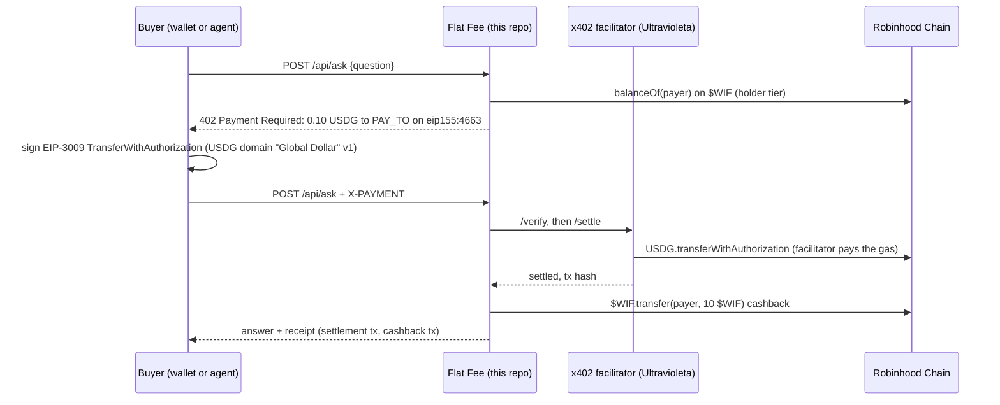

# Flat Fee

> Ask an agent or hire a human for a flat USDG fee per call, paid with one signature over x402 on Robinhood Chain.
> Every paid call sends **$WIF** back, and $WIF holders pay half.

Built for the **world is flat hackathon** (Robinhood Chain). Demo video: `[VIDEO_URL]` · Live demo: `[DEMO_URL]` ·
Form answers: [SUBMISSION.md](SUBMISSION.md) · Video shot list: [docs/DEMO-SCRIPT.md](docs/DEMO-SCRIPT.md)

## The problem

Agents can already answer questions and humans can already run errands, but there is no simple way to sell either one,
call by call, to anyone with a wallet. Subscriptions and API keys exclude agents, and card payments do not work for a
few cents. Robinhood Chain brings stablecoins to a mainstream audience, so we built the smallest useful storefront for
it: an HTTP endpoint that quotes a price in USDG, takes one signature, settles on chain, and serves the answer.

## What it does

- `POST /api/ask` answers questions about Robinhood Chain from live chain data: an address's ETH, USDG and $WIF, the
  latest block and gas, $WIF itself, or which x402 schemes the facilitator settles here.
- `POST /api/hire` puts a task on a board for a human. A person claims it, answers it, and earns $WIF for it.
- Both answer `402 Payment Required` with a price in USDG on Robinhood Chain. The buyer, a browser wallet or an agent,
  signs an EIP-3009 `transferWithAuthorization` for exactly that amount (no gas, no approve). Ultravioleta's
  open-source x402 facilitator verifies it and settles the USDG on chain, and the endpoint serves the call.
- **$WIF** is in the loop on chain: after each settled call the merchant wallet sends $WIF back to the payer
  (cashback), payers holding at least 100 $WIF get the holder price, and humans who complete tasks are paid in $WIF.

### The $WIF flywheel

| what someone does | what happens to $WIF | why they come back |
|---|---|---|
| pays 0.10 USDG for an answer, or 0.50 USDG for a human | the merchant sends 10 $WIF back to them on Robinhood Chain | every 10 paid calls make them a $WIF holder |
| holds 100+ $WIF | it is read on chain (`balanceOf`) when they pay | they pay half: 0.05 USDG per question, 0.25 USDG per task |
| completes a hire task | the merchant sends them 50 $WIF | more $WIF, more tasks, and the holder price when they buy |

Cashback is kept well below the price (10 $WIF is about 0.012 USD at the pool price of 29 Oct 2026, about 12% of a
0.10 USDG call), so it cannot be farmed for profit, and it is capped by what the merchant wallet holds.

## How it works



```
buyer ──POST──▶ Flat Fee ──402 (USDG price)──▶ buyer signs EIP-3009 ──X-PAYMENT──▶ Flat Fee ──verify/settle──▶ facilitator ──▶ Robinhood Chain
                    │                                                                  │
                    └── $WIF balanceOf (holder price)                                  └── answer + $WIF cashback ──▶ buyer
```

## Try it (judges: under 5 minutes, no wallet, no funds)

You need Node 22+ and [Foundry](https://book.getfoundry.sh) (`anvil`) for the fork runs.

1. `git clone [REPO_URL] && cd worldisflat-x402 && npm install`
2. **`npm run demo`** and open http://localhost:3000. It runs on a local fork of Robinhood Chain mainnet with the real
   USDG and $WIF contracts, and has already paid for one question and one hire task from a throwaway wallet. You see
   both rows under **Paid calls**, each with its settlement and its $WIF cashback, and the task under **Task board**.
   Paste the worker token `demo`, enter any address, click **claim**, type an answer and click **complete**: the task
   turns `done` and the worker receives 50 $WIF. (The tx links point at the real explorer and do not resolve there:
   those transactions only exist on the fork.)
3. **`npm run e2e:fork`**: the whole flow as assertions, 22 checks on a fork of mainnet. You see `PASS` for: the 402
   terms, unpaid rejection of bad input, a paid question through the SDK, USDG moving payer → merchant, the settlement
   mined, the $WIF cashback, the landing page's own payment code, a replayed payment refused, three concurrent copies of one payment charged
   once, the holder price, a
   non-holder refused at the holder price, hire → claim → complete with the worker's $WIF, and the facilitator double
   refusing a wrong amount, recipient, asset, network, an expired authorization and a bad signature.
   `npm run e2e:fork -- robinhood-testnet` runs it on a testnet fork (18 checks, no $WIF there).
4. **`npm run verify:testnet`**: against the **real** facilitator on Robinhood Chain Testnet, read-only. You see that our
   EIP-712 domain equals USDG's on-chain `DOMAIN_SEPARATOR()` on both chains, that the facilitator takes a signed
   payment from an unfunded wallet all the way to the balance check (`insufficient_funds`), and refuses an expired one
   (`invalid_timing`).
5. **`npm test`**: unit tests, no network.

On a real network: `cp .env.example .env`, set `PAY_TO`, `npm start`, then
`curl -i -X POST localhost:3000/api/ask -H 'content-type: application/json' -d '{"question":"latest block?"}'` → you see
`402 Payment Required` and the USDG terms. With a funded `PAYER_PRIVATE_KEY`, `npm run buy -- "your question"` pays and
prints the answer with the settlement link (on mainnet: `CONFIRM_MAINNET_SPEND=0.10`, with `PAY_TO` set to the expected
recipient).

## Real transactions on Robinhood Chain mainnet

| what | transaction |
|---|---|
| USDG settlement through the facilitator (payer → merchant, 0.10 USDG) | `[EXPLORER_TX_URL]` |
| $WIF cashback (merchant → payer, 10 $WIF) | `[WIF_TX_URL]` |

Wallets: payer `0x6Ce9DA69A46842DCe90e6a14382Ed06eb1c46af5`, merchant / pay-to `0xb9056196d3D00b4c09ec2E5E123E30b376d39cC6`.
The run that produces them is `CONFIRM_MAINNET_SPEND=0.10 CONFIRM_MAINNET_WIF=10 npm run e2e:mainnet`; it refuses to sign
unless both amounts are given and match exactly.

## Robinhood Chain, USDG, $WIF and x402: where in the code

| technology | how it is used | file |
|---|---|---|
| Robinhood Chain (mainnet 4663, testnet 46630) | chain ids, CAIP-2 names, public RPCs, explorers | `src/config.ts` (`CHAINS`) |
| USDG (Paxos Global Dollar, `0x5fc5…d168`) | the price of every call; EIP-712 domain `Global Dollar` / `1` sent in the 402 `extra` (its on-chain `version()` reverts) | `src/config.ts`, `src/app.ts` (paywalls) |
| $WIF (`0x5173b8ea6923c2d40267890d45c46a3480954773`) | holder tier (`balanceOf`), cashback and worker reward (`transfer`) | `src/chain.ts` (`tierOf`, `sendWif`), `src/app.ts` (`tierFor`, `cashback`, `/complete`) |
| x402 `exact` (EIP-3009) seller side | `createHonoMiddleware` from `uvd-x402-sdk`, one paywall per route and tier | `src/app.ts` |
| x402 buyer side | `X402Client` from `uvd-x402-sdk` (agents, CLI) | `scripts/lib/buyer.ts`, `scripts/buy.ts` |
| x402 in the browser | builds the EIP-712 payment and the `X-PAYMENT` header for a browser wallet | `public/x402-browser.js`, `public/app.js` |
| Ultravioleta x402 facilitator | verifies and settles USDG on Robinhood Chain, pays the gas | `FACILITATOR_URL`, default `https://facilitator.ultravioletadao.xyz` |

## What existed before, and what was built during the hackathon

Pre-existing, used only through public interfaces: Robinhood Chain, USDG, $WIF, Uniswap v4 (where $WIF trades),
Ultravioleta's Rust x402 facilitator ([x402-rs](https://github.com/UltravioletaDAO/x402-rs), Robinhood Chain + USDG
support since July 2026, see its `docs/ROBINHOOD_CHAIN.md`), and the
[uvd-x402-sdk](https://github.com/UltravioletaDAO/uvd-x402-sdk-typescript) npm package.

Built during the hackathon, all in this repo (first commit `2e9072e`, 29 Oct 2026): the app (`src/`), the landing page
and its browser payment code (`public/`), the $WIF tier, cashback and worker reward, the facilitator double and the fork
runs (`src/double/`, `scripts/`), the tests (`test/`), and the deploy recipe (`Dockerfile`, `deploy/aws/`).

## Safety

- Keys live only in `.env` (gitignored). Nothing prints them; `npm run balances` prints addresses only.
- Mainnet spends need the exact amount on the command line (`CONFIRM_MAINNET_SPEND`, `CONFIRM_MAINNET_WIF`) and the
  expected recipient (`PAY_TO` or `CONFIRM_MAINNET_PAY_TO`). The SDK re-reads the 402 before it signs, so the buyer pins
  its choice to the offer it checked: same network, USDG, same recipient, same amount, or nothing is signed
  (`test/buyer.test.ts`).
- The price is decided from the same payment header the SDK pays from (`PAYMENT-SIGNATURE`, else `X-PAYMENT`); a request
  carrying two different payment headers is refused.
- The holder price comes from the address the signature commits to, never from a header: a non-holder who signs the
  holder price is refused (tested on the fork and in `test/app.test.ts`).
- A replayed payment is not served twice. Bad input is refused before the 402, so nobody pays for a rejected request.
  A failed cashback never fails a paid call; the ledger records why. A call that fails after its settlement still answers
  with the receipt. Error text is stripped of URLs before it is stored or returned (an RPC URL can carry an API key).
- The merchant wallet is the cashback budget: give it only the $WIF you are willing to give away. On top of that,
  `WIF_DAILY_BUDGET` (default 500 $WIF) caps what the server sends per day, cashback and rewards together, so a loop of
  paid calls (or a worker hiring themselves from a second wallet) cannot drain it faster than that.
- Hiring and the task board are off without `WORKER_TOKEN` (compared in constant time). Only the worker who claimed a
  task can complete it, and the payer of a task cannot claim it. Workers holding the token are trusted operators.
- A corrupt `state.json` stops the server instead of being overwritten; `npm run reset` clears it.
- If the RPC cannot be read when a payment arrives, the payer is charged the standard price, never less: a holder in that
  moment gets a 402 at the standard price and can pay it or retry.

## Configuration

See `.env.example`. The main settings: `NETWORK` (`robinhood-testnet` or `robinhood`), `PAY_TO`, the four prices,
`WIF_HOLDER_MIN`, `WIF_CASHBACK`, `WIF_WORKER_REWARD`, `MERCHANT_PRIVATE_KEY`, `WORKER_TOKEN`, `FACILITATOR_URL`.
`npm run reset` clears the ledger and the task board before a recording.

## Deploy

`docker build -t flatfee .` builds one small container (`npm start` inside). `deploy/aws/main.tf` runs it on AWS
Lightsail Containers in us-east-2 (nano, 7 USD a month): push the image with
`aws lightsail push-container-image --region us-east-2 --service-name flatfee --label web --image flatfee`, set the
pushed image name and the values in `deploy/aws/terraform.tfvars` (from the `.example`), then `terraform apply`.
`terraform destroy` turns it off.

## What's next

Escrowed human tasks through Execution Market (pay only when the work is accepted), paying humans in USDG as well as
$WIF, an LLM behind the agent, and subscriptions priced in $WIF.

## Team

Ultravioleta DAO: Luis (`[LUIS_X_HANDLE]`) and c0der. Built with help from AI coding agents.

## License

MIT, see [LICENSE](LICENSE). Flat Fee is not affiliated with, endorsed by, or officially connected with
Robinhood Markets, Inc.
